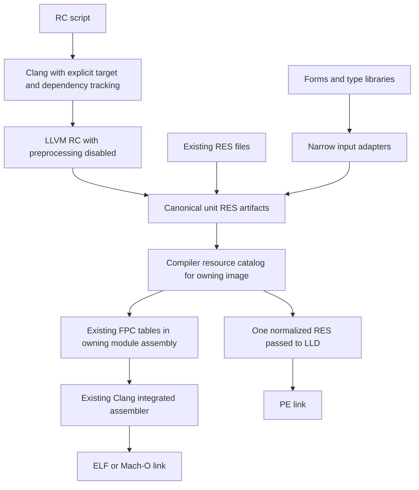

# Replace FPC resource tooling with LLVM

Planning baseline: NexusFPC `2be386ee5a`, 16 October 2026. Implementation was approved on 16 October 2026, with stock FPC 3.2.2 compatibility required and unexpected problems to be discussed before choosing a correction.

## Implementation status

Implementation and the owner-amended acceptance checks are complete against source revision `ca6b3976bf` in `/media/kcollins/dev/worktree/llvm-resource-migration-20261016-ykc1idw1`. The compiler now uses the catalog, LLVM RC pipeline and assembly emitter. Production integration builds from stock FPC 3.2.2, its matching NXU-45 RTL builds, and a subsequent Nexus-built compiler builds with normal SHA-1 selection. The obsolete tools, parser/writer family and sidecars have been removed. The clean stock-seeded bootstrap and final regression/artifact checks pass. Changes remain uncommitted.

### Owner's validation amendment, 16 October 2026

The owner instructed: “Skip native platform validation. just make sure you verify your work via code review and artifact analysis. Continue the rest of the work.” This supersedes native Windows, Android and Apple execution/bootstrap gates throughout this plan, including deletion gates and completion criteria. Those results are **waived**, never reported as passed. Code review, target object/link inspection, metadata compatibility, compiled-unit persistence, available Linux execution and the stock-seeded Linux bootstrap remain required. Target SDK or linker limitations must be recorded explicitly. The earlier native-validation bundle is historical prototype evidence; it does not prove production integration.

The integrated Linux resource API fixture passes all 12 resources through enumeration, languages, repeated handles, payloads and streams without a converter. The exact `cycle22_changec` and `cycle32_changec` first/source-change/cached scenarios also pass with their expected recompilation sets and output `980`. Evidence: `integration-20261016/runtime` and `integration-20261016/cycles`. No concurrency or thread behavior was changed.

### Integrated implementation and current evidence

The compiler records versioned NXRM resource metadata in NXU long revision 45
(header revision 208 is unchanged). `ResourceCatalog`, `ResourceInputs`,
`ResourceTools`, `ResourceArtifacts`, `ResourceMetadata`, `ResourceTables` and
`ResourceEmit` implement bounded normalization, RTL form conversion, explicit
LLVM invocation, transactional artifacts, unit persistence and existing runtime
tables. `comprsrc` owns synchronous collection before assembly; no scheduling
or concurrency algorithms changed. Windows passes canonical RES directly to
LLD. ELF/Mach-O use writable tables and zero-fill handles in the existing
assembly path. Imported packages retain ownership of their resources.

The integrated corpus passes cached payload-only refresh, unchanged timestamps,
failed compilation rollback, two inputs with the same basename, relocated
source-hidden units, forms, DCR, language fallback, enumeration and deferred
linking. All eight checked-in RC scripts pass; the event-log script uses its
pre-generated message asset as a prerequisite. Microsoft MC generation itself
was not exercised. The Windows artifact replacement branch cross-compiles for
all three Windows CPUs. Native Windows execution is waived.

All 13 compiler/RTL combinations build. Actual target-selected RC payloads and
objects pass inspection. Complete resource-bearing programs link for the three
Linux and three Windows targets. Android's two and Apple's five variants pass
SDK-free linked artifact analysis; these are not complete SDK application
links. ARM64 simulator metadata records iOS simulator 14.0. The retained
metadata readers recover all resource identities/payloads from ten linked
non-Windows table images, including old and new ELF version fixtures.

On Linux, the full 12-resource runtime fixture and three repeated shared-library
load/unload cycles pass, with resources resolved inside their owning library.
The source-hidden NXPL provider/consumer artifact test passes using exact
filenames. The owner approved the Linux package-link correction after the test
exposed conventional `-lProvider.nxpl` lookup; existing exact dependencies keep
their colon prefix.

Setup's complete source closure builds against retained metadata readers. Its
23 tests pass with the owner-approved CRC32 correction: the x86 assembler now
uses CRC32's source width instead of the accumulator width. The regression
checks 1,280 instruction/vector/alignment cases and 129 string-hash/dictionary
cases; byte, word, dword and qword instruction encodings are inspected. Setup
now copies two small LLVM-generated version RES fixtures instead of depending
on the retired resource writer. Those consumer edits are in the sibling Nexus
repository under `projects/setup/test`.

The reviewed host suite passes with stock FPC 3.2.2 and Nexus, each with its own
RTL: 233 catalog, 76 input, 49 artifact, 459 metadata and 104 layout checks,
target/encoding tool probes, repeated FileInfo reads and eight frozen metadata
pairs. The Nexus run also includes integrated compiler and CRC/hash regressions.
Evidence is under `integration-20261016/host-reviewed`, `host-stock-reviewed`,
`target-artifacts`, `ownership`, `package-approved-regression`, `setup` and
`trimmed-metadata-tables` in the authorized workspace. Final bootstrap evidence
and the subsequent validation results are recorded below.

### Final clean bootstrap

The integrated migration bootstraps from `/usr/bin/ppcx64` **3.2.2** using the
established seed flags and matching stock RTL. All generators and three Nexus
compiler/RTL cycles pass. Generations 2 and 3 have identical compiler bytes and
all **90** RTL objects match. The resulting compiler SHA-256 is
`668d714ab3a3dbd9ba5c3912fa5e453e6585c930c8d1bebc50c601255abdba21`.
Its immutable source snapshot is
`ca6b3976bf5417fd73251dcb9f39d9edcf48ea07-work-d8cdc45898`;
`artifacts/verified-baseline/ca6b3976bf-work-d8cdc45898/build-identity.json` and
`final-bootstrap.log` record the seed, source digest, tools and convergence.
Despite the historical parent directory name, this snapshot includes the
integrated replacement and approved CRC32/package-link corrections.
No installed compiler was promoted.

The final validation uses this compiler and matching RTL in `final-validation`.
The checked-in host runner, exact six cyclic-unit scenarios, complete Setup
source closure (**23 passed; 0 failed/errors/skipped**), PIC package ownership
and repeated shared-library resource checks pass there. The permanent CRC32
regression also fails at the diagnosed byte-width case when deliberately run
against the uncorrected baseline; evidence is in
`final-validation/crc-baseline-negative/expected-failure.json`.

Production compiler/reader source matches the bootstrap snapshot. The bootstrap
regenerates the two x86 `cpummprocs.inc` files from the checked-in generator;
their difference from the pre-existing checkout copies is Pascal letter case
only. Later edits are documentation and release/regression test improvements.

### Final validation result

`final-validation.log` ends with `FINAL VALIDATION PASSED`.
`final-validation/results.json` records the commands, source identity, durations
and exit codes; `artifact-review.json` records explicit machine/pointer-width,
writable resource-section, zero-fill handle and native PE resource checks for
all 13 targets. LLVM Clang/LLD/inspection tools are 18.1.3, with the matching
LLVM 18 RC executable. This is the validated toolchain baseline.

| Gate | Final result |
| --- | --- |
| Stock-seeded Linux bootstrap | Pass; matching compiler generations 2/3 and 90 RTL objects |
| Host catalog/adapters/tools/artifacts/NXRM/readers/layout | Pass with stock 3.2.2 and matching stock RTL; pass with clean Nexus compiler and matching Nexus RTL |
| Integrated unit resources | Pass; cached refresh, same-basename inputs, relocation, source-hidden consumption, failure rollback, DCR/forms, language fallback, enumeration, deferred links and retired options |
| Cyclic units | All six exact first/source-change/cached scenarios pass; expected compile sets and output 980 |
| Setup | Fresh complete source closure builds; all 23 tests pass |
| CRC32/hash regressions | 1,280 instruction/vector/alignment checks and 129 string/hash checks pass; negative baseline proves regression sensitivity; Win32/Win64 byte/word/dword/qword encodings inspected |
| Package/library ownership | Source-hidden NXPL consumer and provider metadata checks pass; library lookup remains in its owner through repeated load/unload |
| Matrix build | All 13 compiler/RTL combinations pass, including startup assembly prerequisites |
| Target artifacts | All 13 target RC macro payloads and actual objects pass; six full Linux/Windows program links and seven SDK-free Android/Apple artifact links pass |
| Runtime resource API | All 12 resources pass lookup, enumeration, languages, repeated handles, payload and stream checks on Linux |
| Relocated toolchain | Copied compiler/RTL compile and run RC-bearing code from a path containing spaces |
| Generated origins/removal/distribution review | 27 namespace origin/wrapper pairs agree; parser/lexer origins and outputs removed together; no operational converter/writer/sidecar references remain; release masks already retain canonical RES files |
| Native Windows/Android/Apple builds/execution and PowerShell execution | Waived by owner; not represented as passed; no Apple/Android SDK application link or runtime claim |

The final review found no remaining implementation blocker. `git diff --check`
and shell syntax checks pass. No concurrency change was introduced. All execution
outputs are under the authorized worktree, with no repository `build` directory.
Sibling Nexus changes are the Setup fixture migration and its attribution record;
pre-existing `fcl-image` removals are outside this migration's changes.

### Historical implementation batches

The following records describe earlier stages and comparison oracles. References
to prototypes, NXU 44 and pending native gates describe those stages only; the
integrated status above and the owner's validation amendment supersede them.

* The owner selected retirement of external sidecars and embedded resources as the sole output mode.
* The owner authorized direct execution of the documented bootstrap stages for this migration because native Forge is unavailable here. All generated files remain in the external worktree.
* The owner authorized restoration of `FileInfo` with the retained resource metadata code. `packages/fcl-res/src/fileinfo.pas` is an unchanged restoration from `b33f3bce53e299f319980d56adb40aae82ce36c4:packages/fcl-extra/src/fileinfo.pp`, immediately before removal in `f40338cf8a`. Its SHA-256 is `2622f48109d66b99df6f3852247ab3039c518ae14d6c42bc0d243a899c151715`. The existing `Fcl.FileInfo` namespace wrapper moved unchanged to `fcl-res/namespaced`.
* The restored metadata API compiled with both stock FPC 3.2.2 and the verified Nexus compiler, and passed repeated version reads from standard RES and LLVM-generated PE files for Windows i386, x86_64 and ARM64 with each matching RTL. Reproduce with `bash tests/resource-formats/Run-NXFileInfoMetadataTests.sh <compiler> <matching-rtl-units> <external-artifact-directory>`. This does not establish a complete Setup build or target runtime execution.
* A fresh native Linux bootstrap starting with stock FPC 3.2.2 passed all generators, three compiler/RTL cycles, compiler convergence and comparison of all 90 RTL objects in cycles 2 and 3. It followed the existing `/media/kcollins/dev/toolchain/bootstrap-nexusfpc.py` procedure, adapted only for isolated output/snapshot locations and no installed-toolchain promotion. That established procedure already selects `-dSHA1PASCAL` for the stock-built initial seed, then uses normal SHA-1 and LLVM assembly/linking in Nexus-built generations. The earlier failed reproduction omitted this existing seed-stage flag; no SHA-1 source or assembler-policy change was needed or made. The verified baseline compiler SHA-256 is `ae52d814264029ba686b609145e144c0fd3442b7f3c63c48b8c7c265ae047918`. Its source snapshot predates catalog integration. Evidence is in `established-bootstrap-adaptation.json`, `baseline-bootstrap/…/logs`, and `artifacts/verified-baseline/ca6b3976bf-work-4d64bb2de9/build-identity.json` in the workspace.
* The new standalone `ResourceCatalog` and `ResourceInputs` units compile with stock FPC 3.2.2 and with the verified Nexus compiler, each using its own matching RTL. The current batch passes 233 catalog checks and 76 form/TLB checks with each pairing. The catalog validates RES boundaries, identifiers, string blocks and image references; reads/writes payloads in bounded chunks; merges disjoint string slots; and rebases icon/cursor child references. Direct adapters use only RTL streaming and opaque TLB payloads. Reproduce with `tests/resource-formats/Run-NXResourceCatalogTests.sh` and `Run-NXResourceInputsTests.sh`, passing the compiler, matching RTL directory and external artifact directory to each runner.
* Differential validation covers all 15 checked-in RES/DFM/LFM/TLB files and four generated text-form cases. Fourteen checked-in inputs and all four generated cases match the existing implementation's decoded identities, metadata, payloads and resolved image references. Ten text/binary form and TLB outputs are byte-identical across the stock and Nexus RTLs. The remaining file, `packages/pasjpeg/examples/test1.dfm`, is a legacy 16-bit resource wrapper around a `TPF0` stream; the unchanged baseline `fpcres` also rejects it with “No known file format detected.” That example remains unchanged and is not counted as a supported-input pass. Evidence: `artifacts/catalog-differential/corpus-results.json` and the original converter log `logs/test1-baseline-fpcres.log`.
* Additional differential cases passed for seven resources exercising Unicode identifiers, maximum ordinals/language, and named versus numeric IDs; and for eight resources merged from real LLVM-generated ICO/CUR inputs with colliding child IDs. The normalized image and identifier outputs are byte-identical between the stock/Nexus pairings. LLVM accepted both merged string and merged image RES files for X86, X64 and ARM64 object generation. Evidence: `artifacts/catalog-differential/extended-results.json`. These are input/object checks, not Windows runtime execution.
* The owner approved two binary alignment corrections: remove the two excess trailing NUL bytes from `tests/test/units/system/tres4.res`, and append two missing final alignment bytes to `packages/winunits-base/src/w32default.res`. All original resource records and payload bytes are preserved; the new reader remains strict. LLVM accepts the corrected files. The associated `w32default.rc` uses a per-resource `LANGUAGE` position LLVM does not accept; its source-syntax migration belongs to phase 2 and is still pending.
* The original `cycle22_changec` and `cycle32_changec` first/source-change sequences passed with exact expected recompilation sets, plus a cached third compile. Each of the six resulting programs printed `980`. The external harness explicitly requests informational messages (`-vi`), because this compiler's default output is quiet. Evidence: `validate-baseline-cycles.py` and `artifacts/baseline-cycles/results.json`. Package-runtime, full Setup and non-Linux runtime gates remain open.
* The standalone `ResourceTools` suite passes with both stock FPC 3.2.2 and the verified Nexus compiler, each using its matching RTL. It covers all 13 target-macro combinations, ordered/quoted macros, explicit includes, paths with spaces/non-ASCII, payload-only refresh, and subprocess failure cleanup. The accepted encoding guard permits matching/default pragmas and rejects conflicting or malformed directives and malformed UTF-8 before LLVM runs. It preserves source/header line mappings, handles active includes and `_Pragma`, and ignores inactive directives, comments and pragma-like resource strings. Multilingual UTF-8, explicit Windows-1252 and long lines pass. The original LLVM encoding failure is now an explicit rejection under the owner-approved contract. All 24 normalized outputs and their 24 raw LLVM counterparts are byte-identical across the compiler/RTL pairings. Reproduce with `tests/resource-formats/Run-NXResourceToolsTests.sh <compiler> <matching-rtl-units> <external-artifact-directory>`. Evidence: `artifacts/tools-stock-322-encoding-policy/logs` and `artifacts/tools-nexus-encoding-policy/logs`. The prototype is not yet integrated; native Windows execution remains an open gate.

* The standalone `ResourceArtifacts` unit passes 37 staging/normalization checks with each compiler/RTL pairing. It chooses formats by binary signatures before extensions (including Delphi DCR), assigns module/input-index artifact names, stages files beside their final destinations, compares content in 64 KiB chunks and atomically replaces only changed artifacts. Failure/abandonment preserves published files; unchanged artifacts preserve their timestamps. Two inputs with the same basename remain distinct after relocation and hiding original inputs, and LLVM accepts the merged result. These are artifact-layer checks, not a completed NXU/source-hidden compiler integration gate. Reproduce with `tests/resource-formats/Run-NXResourceArtifactsTests.sh <compiler> <matching-rtl-units> <external-artifact-directory>`. Evidence: `artifacts/unit-artifacts-stock-322`, `artifacts/unit-artifacts-nexus`, `artifacts/encoding-artifact-validation.json`. The Windows replacement branch still requires native Windows execution.
* The owner approved the one-line shared ARM64 iOS simulator target correction in `compiler/triplet.pas`: put the deployment version before `-simulator`. Using the actual before/after units with a consistent ARM64 compiler dependency closure, a requested 14.0 now produces preprocessor version 140000 and Mach-O simulator deployment 14.0; a requested 17.0 produces 170000 and deployment 17.0. Before correction the preprocessor reported 70000 for both and the assembler emitted deployment 14.0 for both. The initial isolated probe mixed CPU-specific unit sets and was rejected by checksum validation; the subsequent full ARM64-target compiler build supplies a consistent closure. No dependency checks were bypassed. Evidence: `artifacts/iossim-triplet-review/actual-results.json`, `actual-commands.json` and `arm64-compiler/compile.log`. This is Linux-hosted target/preprocessor/object validation, not an Apple runtime result.

* The standalone `ResourceTables` layout passes 104 checks with both compiler/RTL pairings. It emits the existing packed FPC header/tree/handle ABI for 4- and 8-byte target pointers through an abstract assembly sink, sorts identifiers by the RTL's UTF-8 byte order, rejects lossy surrogate conversion before emission, and sends payload/name bytes in chunks of at most 64 KiB. LLVM assembles all ten non-Windows objects; LLD links all ten data-only shared images with current defaults and section GC. The retained readers recover all 12 identities, language IDs and payloads from the five ELF objects and all ten linked images. The restored `TVersionInfo` API passes repeated 1.2.3.4 → 5.6.7.8 → 1.2.3.4 reads on all ten linked formats with both compiler/RTL pairings. FileInfo uses extensionless Unix executable fixture names under its existing extension registration; stream-level reader checks are independent of suffix. This is file-format and metadata API validation on Linux, not target runtime execution or compiler assembly-backend integration. Reproduce with `tests/resource-formats/Run-NXResourceTablesTests.sh <compiler> <matching-rtl-units> <external-artifact-directory>`. Evidence: `artifacts/tables-stock-322`, `artifacts/tables-nexus`.
* The owner approved an ELF reader correction after the linked-image gate exposed an overflow on 64-bit LLD shared/PIE resource images. A minimal VERSIONINFO input through the unchanged baseline converter reproduced the same failure on x86_64 and aarch64; i386 passed. `elfsubreader.inc` now resolves symbol-free `R_X86_64_RELATIVE` / `R_AARCH64_RELATIVE` addends from `.rela.dyn` when reading `ET_DYN`. Existing relocatable-object and fixed-address paths remain covered. The relocation table uses checked bounds/chunked reads, filters relative entries, sorts dynamic offsets and rejects malformed entries/duplicates. Unsorted and five malformed-relocation cases pass for all four 64-bit ELF target rows under each compiler/RTL pairing. Repeated FileInfo version reads also pass for old-converter i386/x86_64/aarch64 images with both pairings. No linker flag or runtime resource ABI changed. Evidence: `artifacts/tables-stock-322/analysis/elf-version-baseline-results.json`, `elf-version-correction-results.json`, and the table suite logs.
* Raw LLVM Mach-O objects contain unresolved symbol relocations that the retained Mach-O metadata reader does not apply. The original raw-object failure is preserved in `artifacts/tables-stock-322/analysis/raw-macho-reader-failure.log` with `diagnosis.json`; all five linked Mach-O images pass the full identity/payload comparison. Compiler-internal raw Mach-O objects are not counted as executable-reader passes. The broad legacy converter fixture separately rewrote non-ASCII identifiers through an ANSI conversion (`雪` became `?`, `café` used a single E9 byte). That mismatch is isolated from the relocation failure by the minimal VERSIONINFO reproduction. The new catalog/table path uses explicit UTF-8 and preserves the Unicode identifiers, including the BMP/supplementary ordering case. Evidence: `analysis/legacy-unicode-cli-diagnosis.json`; the retiring converter is unchanged.
* `ResourceEmit` translates the validated layout into the compiler's existing section, symbol, pointer, string and zero-fill assembly items. It uses target `SizeOf(PInt)`, writable ELF/Mach-O data, and zero-fill handles. All ten non-Windows target variants assemble, link and pass retained-reader comparisons with both stock 3.2.2 and Nexus compiler/RTL pairs using consistent CPU-specific compiler-unit closures. The i386 closure emits 4-byte pointers on this 64-bit host. The native Linux RTL API test passes all 12 fixture resources, enumeration, languages, repeated handles, complete payloads and streams. This adapter test substitutes only the new resource object into the unchanged compiler's no-link output, then executes its original link recipe; it does not establish production collection/scheduling integration. The initial harness access violation was traced to its omitted parser-owned `SmartLinkOFiles` initialization and corrected in the harness. Evidence: `artifacts/compiler-resource-emit/pair-validation.json` and `native-runtime/emitter-runtime-results.json`. Reproduce object/link/reader checks with `Run-NXCompilerResourceEmitTests.sh`, supplying the matching compiler, RTL, target CPU, compiler-unit closure, compiler includes, table fixture and external output directory.
* The standalone `ResourceMetadata` prototype preserves original input/directive locations, module/input artifact basenames, format, target identity, per-unit RC codepage, includes and ordered macro arguments. Its versioned `NXRM` stream uses checked lengths, bounded reads/writes and transactional loading. Both compiler/RTL pairs pass 459 checks and emit byte-identical metadata. Malformed records, duplicate/path-traversing artifact names and unsupported macro argument kinds are rejected. Long fields do not use short-string serialization. Tool executable paths remain current-host settings. This schema is not yet wired into NXU `IBResources`; the NXU long revision remains 44 until that integration and the required clean rebuild. Evidence: `artifacts/metadata-results.json`. Reproduce with `Run-NXResourceMetadataTests.sh <compiler> <matching-rtl> <external-output>`.
* The owner requested test bundles and commands for the unavailable Windows, Android and Apple native checks. Host suites and target runtime gates remain separate. `Run-NXResourceHostChecks.ps1` covers native host RC invocation, normalization, staging, encoding and old/new executable metadata fixtures; `Run-NXResourceHostChecks.sh` aggregates the corresponding Unix-hosted suites. Native target runtime results and compiler integration/removal gates remain pending.
  The prepared bundle is `validation-bundles/nx-resource-validation-20261016` in the authorized workspace, with source/fixture hashes and [native instructions](tests/resource-formats/Native-Validation.md). Its Unix host runner passes all seven suites and sixteen old/new metadata-image pairs with both compiler/RTL pairings. Its isolated runtime preparation command links and executes successfully on Linux x86_64. Simulator/device app packaging passes structural file/plist checks using minimal C Mach-O executables; these are not Apple execution results. PowerShell, native Windows/Android/Apple runtime, signing and installation checks require the owner's machines. The prototype bundle deliberately preserves the unchanged compiler's no-link recipe and the retiring converter only as an explicit comparison prerequisite.

Use Clang and LLVM to compile resource scripts, let LLD construct Windows resource objects, and emit the remaining FPC resource data through the compiler's existing assembly machinery. Retire `fpcres`, the Pascal RC parser and preprocessor, and the separate resource object writers after their replacements pass the gates below. Keep the executable metadata readers needed by Nexus Setup.

LLVM does not implement FPC's ELF/Mach-O resource tables, unit resource ownership, Delphi form conversion, or all existing aggregation behavior. A small compiler-owned resource catalog must preserve those responsibilities. Retaining the current non-Windows runtime data contract avoids replacing a working lookup API with a second resource parser in every application. The benefit comes from removing object-format and RC-language implementations, rather than moving them behind a renamed converter.

## Scope and supported platforms

The retained matrix has 13 combinations, defined in [NexusFPC.Forge.md](/media/kcollins/dev/source/nexus-fpc/NexusFPC.Forge.md:33):

| Platform | CPUs | Resource representation after replacement |
| --- | --- | --- |
| Linux | i386, x86_64, aarch64 | Existing FPC tables in ELF, emitted through LLVM |
| Windows | i386/win32, x86_64/win64, aarch64/win64 | Native PE resources, constructed by LLD |
| Android | x86_64, aarch64 | Existing FPC tables in ELF, emitted through LLVM |
| macOS | x86_64, aarch64 | Existing FPC tables in Mach-O, emitted through LLVM |
| iPhone simulator | x86_64, aarch64 | Existing FPC tables in Mach-O, emitted through LLVM |
| iOS | aarch64 | Existing FPC tables in Mach-O, emitted through LLVM |

All retained targets are little endian. Only i386 uses 32-bit pointers. Preserve those two actual pointer widths; new compiler resource code does not need support for retired CPUs, big-endian native objects, OMF, or XCOFF.

Native development must work on both Linux and Windows. The checked-in Forge bootstrap is currently Windows hosted; [README.md](/media/kcollins/dev/source/nexus-fpc/README.md:35) explicitly defers Linux-hosted Forge builds. Native Linux compiler operation and Linux Forge orchestration are separate acceptance items.

**Temporary compatibility requirement:** Stock FPC 3.2.2 must remain able to build the initial Nexus compiler until the project has adopted its own seed compiler. Resource modernization must not raise that minimum version. New compiler units and seed-stage generators must use syntax and host RTL APIs available in 3.2.2. Keep this requirement until an explicit seed-transition decision supersedes it.

All implementation work and validation artifacts must use a unique directory under `../../worktree`, with subdirectories such as `artifacts`, `units`, `obj`, and `logs`. The current Forge recipes contain hardcoded `build/forge-bootstrap` paths. Parameterize the relevant output root before using them for this migration. Do not recreate a `build` directory.

Resource tool invocation, catalog construction, and final linking remain synchronous. This work includes no thread, queue, parallel compilation, package lifecycle, or concurrency redesign.

## Baseline resource architecture (before migration)

### Compiler flow

| Stage | Actual behavior | Source |
| --- | --- | --- |
| Parse directives | `{$R}` and `{$RESOURCE}` add filenames to the module's `ResourceFiles`. Leading `*` expands to the source basename; a missing extension becomes the target resource extension. The module records that it has resources. | [scandir.pas](/media/kcollins/dev/source/nexus-fpc/compiler/scandir.pas:1294) |
| Own resource references | Each `TModule` owns its resource filename list. These are filenames, not embedded resource payloads. | [fmodule.pas](/media/kcollins/dev/source/nexus-fpc/compiler/fmodule.pas:625) |
| Persist unit resources | `WriteResources` and `ReadResources` serialize resource filenames through the compiled unit's `IBResources` record. The source calls this a PPU; this fork distributes `.nxu` units. | [fppu.pas write](/media/kcollins/dev/source/nexus-fpc/compiler/fppu.pas:991), [read](/media/kcollins/dev/source/nexus-fpc/compiler/fppu.pas:1400) |
| Normalize each module's inputs | `CompileResourceFiles` resolves paths, copies existing resource inputs beside compiled units when needed, or invokes an RC compiler to produce `.res`. Forms and type libraries are recognized as already consumable converter inputs. | [comprsrc.pas](/media/kcollins/dev/source/nexus-fpc/compiler/comprsrc.pas:420) |
| Locate and launch tools | `TResourceFile.Compile` chooses the RC compiler or resource converter, searches the host utilities paths/PATH, substitutes command templates, and waits for the process. Failure prevents linking. There is also deferred command/script handling for no-link operation. | [comprsrc.pas](/media/kcollins/dev/source/nexus-fpc/compiler/comprsrc.pas:139) |
| Aggregate the final image | `CollectResourceFiles` walks used units and the final module, resolves resource filenames, and writes a converter response list. Imported package units are explicitly skipped because their resources belong to the provider image. | [comprsrc.pas](/media/kcollins/dev/source/nexus-fpc/compiler/comprsrc.pas:492) |
| Convert and link | `TWinLikeResourceFile.EndCollect` runs `fpcres` once on the collected inputs. It produces COFF, ELF, Mach-O, or an external sidecar according to target policy. Native objects enter the link object list. | [comprsrc.pas](/media/kcollins/dev/source/nexus-fpc/compiler/comprsrc.pas:380), [link.pas](/media/kcollins/dev/source/nexus-fpc/compiler/link.pas:318) |
| Establish runtime access | The compiler emits `FPC_RESLOCATION` pointing to `FPC_RESSYMBOL` for embedded ELF/Mach-O resources, or nil when appropriate. Automatic resource-unit selection and removal also account for provider package ownership. | [ngenutil.pas](/media/kcollins/dev/source/nexus-fpc/compiler/ngenutil.pas:1533), [pmodules.pas](/media/kcollins/dev/source/nexus-fpc/compiler/pmodules.pas:255) |

The ordering matters. Today module resource compilation runs **after** `GenerateAsm` in [pmodules.pas](/media/kcollins/dev/source/nexus-fpc/compiler/pmodules.pas:114), and final resource collection runs later, before linking at lines 2211 and 2274. Emitting the final resource tables into the owning image's assembly requires normalization and catalog finalization before that assembly is written. This is a compiler scheduling change with explicit cyclic-unit and package regression gates; it must not change unit compilation concurrency.

### Tool selection and target defaults

| Selection | Current purpose | Proposed treatment |
| --- | --- | --- |
| `-FC<path>` | RC script compiler override, stored in `RCCompiler` | Retain as the explicit LLVM RC executable override; validate tool kind and document its narrower contract. |
| `-FR<path>` | Resource-to-object converter override, stored in `ResCompiler` | Retire after object conversion disappears from the compiler pipeline. |
| `-FF` | Force `fpcres` to parse `.rc` | Retire with a clear diagnostic. |
| `-FD`, `-XP` | Utilities directory and executable prefix | Preserve host-tool discovery intent; resource tools must be host executables even when producing cross-target data. |
| `-Fi` and source paths | Contribute include searches and input resolution | Feed explicit, ordered resource include configuration. |
| `-We` | Apple external `.fpcres` resources | Subject to the sidecar retirement gate below. |
| `-Wi` | Select Apple embedded Mach-O resources | Retain as an explicit embedded-mode selection if useful; remove only redundant mode-switch machinery after the sidecar decision. |

These controls are implemented in [options.pas](/media/kcollins/dev/source/nexus-fpc/compiler/options.pas:2572), [resource argument construction](/media/kcollins/dev/source/nexus-fpc/compiler/comprsrc.pas:249), and [Apple external selection](/media/kcollins/dev/source/nexus-fpc/compiler/options.pas:3399). Pascal source codepage selection (`-Fc`) and RC input codepage are distinct concerns and must not be conflated.

Linux and Android register `Res_ELF_Info`; Apple targets use Mach-O information, with an external variant. These templates still select `windres` for RC and `fpcres` for conversion. All three live Windows targets select `res_gnu_windres`, also backed by `fpcres` for conversion. A Win64 `gorc` registration remains, although it is not the default. See [rescmn.pas](/media/kcollins/dev/source/nexus-fpc/compiler/rescmn.pas:33), [i_darwin.pas](/media/kcollins/dev/source/nexus-fpc/compiler/systems/i_darwin.pas:32), [i_win.pas](/media/kcollins/dev/source/nexus-fpc/compiler/systems/i_win.pas:74), and [t_win.pas](/media/kcollins/dev/source/nexus-fpc/compiler/systems/t_win.pas:99).

`TRes` and `TScriptType` also retain historical resource-driver names in [systems.inc](/media/kcollins/dev/source/nexus-fpc/compiler/systems.inc:129). Remove obsolete entries only after checking serialization and array indexing. Preserve `TSystem` and `TSystemCPU` numeric identities.

### What fcl-res and the utilities provide

`fpcres` is a general converter, not just a Windows RC compiler. Its [uses list](/media/kcollins/dev/source/nexus-fpc/utils/fpcres/fpcres.pas:23) registers standard RES, RC, forms, type libraries, COFF, PE-image, ELF, Mach-O, and external-resource readers, plus five output families. Its command parser, target selection, input streaming, diagnostics, and response-file handling are additional utility code.

| Responsibility | Principal units | Nature |
| --- | --- | --- |
| Resource model, streams, registration and tree | `resource`, `resfactory`, `resdatastream`, `resourcetree`, `strtable` | Generic resource data handling; also used by executable metadata readers. |
| Pascal RC compiler and preprocessor | `rcreader`, `rcparser.y` and generated `rcparser.pas`, `rclex.l` and generated `rclex.inc`, `rcparserfn.inc`, `yyinclude`, `yypreproc` | Duplicates functionality LLVM can supply. Depends on `tplylib`. |
| Standard RES input/output | `resreader`, `reswriter` | Generic Windows resource records; a bounded subset remains necessary for normalization. |
| Duplicate handling | `resmerger`, string-table and group resource classes | Required semantics are more than byte concatenation. |
| Form conversion | `dfmreader` | FPC/Delphi compatibility adapter, including RTL text-to-binary form streaming. |
| Direct type-library input | `tlbreader` | Recognizes MSFT/SLTG type libraries and wraps a resource payload. |
| Native object output | `coffwriter`, `elfwriter`/`elfsubwriter.inc`, `machowriter`/`machosubwriter.inc` | COFF is replaceable by LLVM directly; ELF/Mach-O combine FPC layout logic with hand-written object-format machinery. |
| Executable/object metadata input | PE/COFF, ELF, and Mach-O readers and their type/constant units | Needed by Nexus Setup; not replaced by compiling RC scripts. |
| External sidecar input/output | `externalreader`, `externalwriter`, `externaltypes` | Custom FPCRES container, not a native object format. |

Two existing semantics require explicit preservation:

* [TResourceMerger.Merge](/media/kcollins/dev/source/nexus-fpc/packages/fcl-res/src/resmerger.pas:57) merges disjoint nonempty strings in the same 16-entry string-table block. Overlapping nonempty entries are an error, including equal strings. `TResources.InternalAdd` invokes it before reporting a duplicate.
* Group icon/cursor resources manage child image ownership and can reassign child IDs when moving between resource collections. See [group icon ownership](/media/kcollins/dev/source/nexus-fpc/packages/fcl-res/src/groupiconresource.pas:210) and [group cursor ownership](/media/kcollins/dev/source/nexus-fpc/packages/fcl-res/src/groupcursorresource.pas:240). A replacement must preserve group-to-image references across separately compiled files and languages.

[dfmreader.pas](/media/kcollins/dev/source/nexus-fpc/packages/fcl-res/src/dfmreader.pas:145) obtains the resource name from the root class, uppercases it, and wraps the binary stream as RCDATA. Text forms go through `Classes.ObjectTextToBinary`. Embedding an unchanged text `.lfm` as arbitrary RCDATA would change behavior.

### Runtime contracts

Windows uses native PE resources through [winres.inc](/media/kcollins/dev/source/nexus-fpc/rtl/win/winres.inc). The relevant resource manager forwards lookup, loading, sizing and enumeration to Windows APIs. Each EXE/DLL/package needs its own image handle; resource aggregation must not copy an imported package's resources into its consumer.

Other retained platforms use [intres.inc](/media/kcollins/dev/source/nexus-fpc/rtl/inc/intres.inc:19). `TResHdr` holds a root pointer, resource count, mutable handle count, and handle-array pointer. `TResInfoNode` holds a name/ID, counts or handle/size fields, and a child/data pointer. The table uses relocated native pointers. Header/node fields and the handle pool are writable at runtime. Preserve packing, pointer width, lookup order, current case/language behavior, `#number` handling, and module-handle resolution. The latter includes lookup of an exported `rsrc` function or `FPC_RESLOCATION` symbol for other images.

The ELF writer emits `fpc.resources` as allocated writable data and `fpc.reshandles` as allocated writable NOBITS storage. The Mach-O writer emits corresponding named sections and pointer relocations; AArch64 uses actual symbols for references across sections. Sources: [ELF section construction](/media/kcollins/dev/source/nexus-fpc/packages/fcl-res/src/elfsubwriter.inc:399), [handle storage](/media/kcollins/dev/source/nexus-fpc/packages/fcl-res/src/elfwriter.pas:496), [Mach-O symbols](/media/kcollins/dev/source/nexus-fpc/packages/fcl-res/src/machowriter.pas:581), [pointer relocations](/media/kcollins/dev/source/nexus-fpc/packages/fcl-res/src/machosubwriter.inc:128), and [packed data definitions](/media/kcollins/dev/source/nexus-fpc/packages/fcl-res/src/fpcrestypes.pas:25).

Keep `FPC_RESSYMBOL`, `FPC_RESLOCATION`, and startup `TEntryInformation.ResLocation`. Apple startup references `FPC_RESLOCATION` unconditionally, including the no-resource case: [sysinit.pas](/media/kcollins/dev/source/nexus-fpc/rtl/darwin/sysinit.pas:33). Preserve `TResourceManager`, resource APIs, `TResourceStream`, and component streaming in `Classes`. A generated resource section must survive stripping and section garbage collection while remaining writable where the runtime requires it.

External resources are a separate runtime: `fpextres.pas`, `extres.inc`, and Apple `extres_multiarch.inc` load/map a custom `.fpcres` container. `fpcreslipo` shares/thins data in that format. LLVM's `llvm-lipo` operates on Mach-O slices and does not replace it.

Pascal `resourcestring` tables are independent. [InsertResourceTablesTable](/media/kcollins/dev/source/nexus-fpc/compiler/ngenutil.pas:1486), `cresstr`, `.rsj` localization, `rstconv`, and package resourcestring registration remain in place.

### Other consumers and bootstrap closure

Nexus Setup imports `FileInfo`, `resource`, `versiontypes`, `winpeimagereader`, `elfreader`, and `machoreader`. Its [ReadVersion](/media/kcollins/dev/source/nexus/projects/setup/src/utNXSetupFiles.pas:175) reads executable file versions to decide installation/replacement behavior. Its [tests](/media/kcollins/dev/source/nexus/projects/setup/test/tsNXSetupTests.pas:30) also construct synthetic resources with `versionresource`, `resreader`, and `reswriter`. Removing the whole `fcl-res` package would break this dependency. Retain readers for older installed images as well as newly produced images.

The audit found a missing `FileInfo` implementation: it had moved upstream from `fcl-base` to `fcl-extra`, then was deleted with `fcl-extra` in `f40338cf8a` on 16 September 2026. The owner authorized restoring that unit with the retained metadata code. The restored implementation and namespace wrapper now reside in `packages/fcl-res`; the focused API validation is recorded above. Setup's complete build remains a separate gate.

The compiler's resource orchestration currently does not depend on `fcl-res`; the external converter does. Forge stages `fcl-res`, its supporting packages, and `tplylib` for host tools, builds `fpcres` and `fpcreslipo`, and advertises the converter in `Build:Tools`. It builds `fpintres` across the matrix and `fpextres` for Apple. Release/SDK recipes retain unit resource artifacts. See [tool staging](/media/kcollins/dev/source/nexus-fpc/NexusFPC.Forge.Tools.nxscript:35), [tool compilation](/media/kcollins/dev/source/nexus-fpc/NexusFPC.Forge.Tools.nxscript:163), [tool output contract](/media/kcollins/dev/source/nexus-fpc/NexusFPC.Forge.nxscript:1080), and [Apple resource RTL](/media/kcollins/dev/source/nexus-fpc/NexusFPC.Forge.nxscript:1763).

No filename-bearing `{$R}`/`{$RESOURCE}` directives were found in the current compiler and RTL sources. Building the compiler and resource-manager RTL units therefore does not by itself exercise resource conversion. The validation must compile explicit resource-bearing fixtures. Package examples and tests supply existing RES, RC, DFM, TLB and `.dcr` use cases; `winmanutf8lfn` embeds `w32default.res`, and the JPEG orientation test explicitly selects `-FF` for `dots.rc`.

After replacement, resource handling needs the base RTL, the RTL form-streaming closure, and the existing LLVM toolchain. Reusing `Classes.ObjectTextToBinary` adds an explicit host-compiler dependency on `Classes`. Stock FPC 3.2.2 already supplies this API in its own RTL; the initial compiler must link that matching stock RTL. Subsequent Nexus-built stages use the project's `Classes` and its RTL dependencies, including `TypInfo`, `Types`, `SortBase`, and `RtlConsts`. The existing native Linux bootstrap already compiles `rtl/linux/buildrtl.pas`, which provides this closure before the next compiler cycle; preserve that established ordering. The current compiler primarily uses its own `CClasses`/`CStreams`; keep stream adaptation local to the form adapter. This is RTL reuse, not a dependency on optional `fcl-res`/`tplylib`. `tplylib` can leave the resource dependency closure, but remains needed if the separately shipped `plex`/`pyacc` generators remain supported.

### Preserve the FPC 3.2.2 bootstrap boundary

The current Windows recipe explicitly uses stock Win32 FPC 3.2.2 and its installed RTL to build the initial Nexus compiler, then uses that compiler to build the project's Win64 RTL and native compiler. See [BuildSeedCompiler](/media/kcollins/dev/source/nexus-fpc/NexusFPC.Forge.nxscript:86) and [BuildNativeSeedCompiler](/media/kcollins/dev/source/nexus-fpc/NexusFPC.Forge.nxscript:330). Preserve that sequence. The native Linux bootstrap likewise starts with stock FPC 3.2.2 and its matching host RTL.

Do not ask stock 3.2.2 to compile the project's current `Classes` sources: they enable `FUNCTIONREFERENCES`, and `classesh.inc` contains `reference to` declarations. Those belong on the Nexus-built side of the boundary. New resource code must use the common stream/form API subset and qualify types where the compiler's own stream classes would otherwise conflict. Compare form conversion through the stock-linked initial compiler and the Nexus-linked later compiler on the retained corpus; the presence of the same API name alone does not prove identical semantics.

The following are mandatory bootstrap checks:

* Stock Win32 3.2.2 builds the initial compiler and generators using stock units; stock Linux x86_64 3.2.2 does the same on Linux. Do not substitute an existing Nexus compiler for this check.
* The initial Nexus compiler builds the current RTL/form-streaming dependencies and the next compiler. Subsequent generations use matching Nexus units, with convergence checked under the established bootstrap procedure.
* A 32-bit Windows seed compiler targeting 64-bit code emits resource fields and relocations using **target** widths. Host `SizeOf(Pointer)` or host record layouts must not determine the resource object's layout.
* Any new NXU resource metadata is written/read by Nexus compilers. Stock 3.2.2 consumes its own compiled units when building the initial compiler; it is not required to read Nexus NXU files.
* Retain the stock compiler's existing assembler/linker prerequisites for the initial stage. LLVM resource/assembler/linker arguments apply when the resulting Nexus compiler runs; do not pass Nexus-only switches to stock 3.2.2.

External LLVM processes do not require LLVM language or ABI support in the Pascal seed. The proposed CLI integration therefore introduces no inherent need to raise the bootstrap compiler version. New Pascal syntax, unavailable RTL calls, or incorrect stage ordering could still break it and must be caught by these checks.

## LLVM capability matrix

The executable probes used LLVM/Clang/LLD **18.1.3 on Linux**. The public LLVM source was inspected at `llvmorg-18.1.3`. The current `llvm-rc`, Windows-resource implementation, and LLD conversion path were also checked at upstream commit `0c60f7ea8be23e4732af5ead9371e3360f7ab7d8`, dated 16 October 2026. Pin and test the project's supported LLVM version range during implementation; installed tool availability alone is not a distribution contract.

| Facility | Verified capability | Integration or limitation |
| --- | --- | --- |
| `llvm-rc` | `.rc` to standard Windows `.res`; RCDATA, STRINGTABLE, include and `RC_INVOKED` probes passed. | It is not a binary RES-to-object converter. Full application syntax/codepage parity needs the corpus below. |
| RC language implementation | LLVM's parser explicitly handles accelerators, bitmap, cursor, dialog/dialogex, HTML, icon, menu/menuex, RCDATA, string tables, version information, and user-defined resource types. | Parser support establishes available syntax families, not equivalence for every application script. [Parser source](https://github.com/llvm/llvm-project/blob/llvmorg-18.1.3/llvm/tools/llvm-rc/ResourceScriptParser.cpp). |
| Built-in RC preprocessing | LLVM 18 invokes Clang automatically. | Native `llvm-rc` derives a Windows triple from the host architecture. A bare executable swap can supply wrong target macros. Use explicit target-aware preprocessing. [Driver source](https://github.com/llvm/llvm-project/blob/llvmorg-18.1.3/llvm/tools/llvm-rc/llvm-rc.cpp). |
| Clang preprocessing | Explicit `--target`, `-E`, `-DRC_INVOKED`, include paths/defines, and dependency-file generation work with RC source. | Keep source mappings and RC include/codepage behavior coherent through the second stage. Clang's C dependency scan does not discover binary filenames named inside RC statements; LLVM 18 RC exposes no corresponding payload depfile option. |
| `llvm-windres` | LLVM's GNU-style interface accepts RC/RES input and RES/COFF output. RC preprocessing honors explicit `--target`; full triples work as well as supported PE aliases. | It is LLVM, not GNU binutils, but availability/basename aliases vary: only the versioned command was on PATH here. COFF input, RC output, ELF output, and Mach-O output were rejected. It can be supported as an explicit frontend choice without retaining a GNU tool dependency. |
| `llvm-cvtres` | RES-to-COFF worked for X86, X64, ARM64. `/TIMESTAMP:0` controls reproducibility. | Useful for a separately required COFF artifact. Unnecessary for ordinary final PE linking because LLD can consume RES directly. [Tool source](https://github.com/llvm/llvm-project/blob/llvmorg-18.1.3/llvm/tools/llvm-cvtres/llvm-cvtres.cpp). |
| LLD COFF | Direct RES inputs linked into valid inspected PE images for all three Windows machines. Multiple inputs with distinct resource tuples combined. | The compiler must pass a normalized RES as a real link input. LLD's [conversion path](https://github.com/llvm/llvm-project/blob/llvmorg-18.1.3/lld/COFF/DriverUtils.cpp) handles native object construction internally. |
| LLVM aggregation | Resource records are indexed by type/name/language; duplicate tuples are diagnosed. | No disjoint-string-block merge or group-image ID repair equivalent to the FPC model was found. Treat these as normalization responsibilities, not linker features. [Implementation](https://github.com/llvm/llvm-project/blob/llvmorg-18.1.3/llvm/lib/Object/WindowsResource.cpp). |
| LLVM object libraries | `WindowsResourceParser` and `writeWindowsResourceCOFF` expose native Windows resource functionality in C++; MC supports ELF, COFF and Mach-O streamers. | These do not supply FPC tables, resource lifetime or unit semantics. A C++ bridge would add LLVM API/ABI and bootstrap packaging work. [Resource API](https://github.com/llvm/llvm-project/blob/llvmorg-18.1.3/llvm/include/llvm/Object/WindowsResource.h), [MC factory API](https://github.com/llvm/llvm-project/blob/llvmorg-18.1.3/llvm/include/llvm/MC/TargetRegistry.h). |
| Clang integrated assembler | Generic data, included payload bytes, and pointer relocations assembled and were inspected for all 13 targets. A Linux x86_64 example linked and executed correctly. | This proves the required object primitives, not a complete FPC resource emitter. Packed tables, PIC, section flags, linker retention, and runtime APIs still need implementation validation. |
| `llvm-objcopy` | Adds/copies native object sections in supported formats. | Raw payload sections do not create FPC directories, native pointers, mutable handles, or the required startup symbols. It is not a complete resource pipeline. |
| `llvm-lipo` | Combines native Mach-O slices. | It cannot thin/share the custom FPCRES sidecar format. |

### Observed compatibility gaps

Two separately compiled RES inputs containing STRINGTABLE IDs 1 and 2 both contain native `RT_STRING`, block 1, language 1033. LLD and `llvm-cvtres` reject that duplicate block. FPC's current merger combines the entries. Passing every unit's RES straight to LLD is therefore not equivalent. The same-block rejection was reproduced for Windows i386, x86_64, and aarch64. Distinct files containing identical resource tuples are also rejected. Supplying the same filename twice can be deduplicated by the driver; that is not evidence of semantic duplicate acceptance.

The target-macro probe selected resource ID 201 under bare `llvm-rc` on this x86_64 Linux host because its preprocessor target was Windows x64. Explicit i386 Windows preprocessing selected ID 202. A Linux-targeted `llvm-windres` invocation selected IDs 202 and 203, showing that the target OS also changes macro behavior. The compiler must own an explicit macro policy rather than inherit host defaults.

The implementation baseline additionally probed all eight checked-in RC scripts using both the unchanged Pascal RC compiler and explicit-target Clang/LLVM. Five compile through both paths. Two lack inputs in this environment in both paths: `fclel.rc` names the absolute `C:\\TEMP\\fclel.msg`, and `tresb.rc` includes the unavailable `windres.h`. These rows remain incomplete; they are not passes. `w32default.rc` compiles with the Pascal parser but LLVM rejects `LANGUAGE` between a numeric type and its filename. Moving `LANGUAGE 0, 0` to its own preceding statement and quoting the XML filename compiles with LLVM. Its manifest source matches the stored payload after CRLF normalization. The checked-in RC source is not changed yet. Evidence: `artifacts/rc-corpus-baseline/results.json`.

The owner approved preserving the compiled dialog output by changing the example script at the LLVM cutover. LLVM combines default control styles with explicit styles: the password edit in `testdlg.rc` gains `WS_BORDER` (`$500100A0` becomes `$508100A0`). Its DIALOGEX font weight is 400, as written in the source; the old parser resets that weight to 0 when it applies `dialog_set_font` after `opt_font_ex`. The approved, staged two-line alternative explicitly removes the border with `NOT $00800000` and requests weight 0; LLVM then emits both original dialog payloads exactly. It has not been applied while the old path is active: the old parser interprets `NOT` as bitwise complement, producing style `$FF7FFFFF` for that expression, rather than LLVM's style-removal mask. The initial claim that the old parser rejected the syntax was incorrect. Evidence: `artifacts/rc-corpus-baseline/compatibility-review/decision.json`, its patch and `artifacts/codepage-analysis/old-dialog-not.log`. No change to LLVM behavior is proposed.

The owner also approved retaining LLVM's default legacy `MemoryFlags` values for newly compiled RC resources. [Microsoft's RESOURCEHEADER documentation](https://learn.microsoft.com/en-us/windows/win32/menurc/resourceheader) and [FPC's MemoryFlags documentation](https://www.freepascal.org/docs-html/fclres/resource/tabstractresource.memoryflags.html) state that these attributes are ignored by the Windows/FPC runtimes. Preserve all metadata read from existing RES files and the old direct form/TLB defaults. No metadata-rewriting compatibility shim has been added. Apart from the two dialog fields above and those flags, all five RC scripts that compile through both paths have identical decoded resources. Evidence: `artifacts/rc-corpus-baseline/semantic-comparison.json`.

**LLVM encoding limitation:** LLVM 18.1.3 ignores `#pragma code_page(...)` in the preprocessed RC input. A UTF-8 `café` string under `/C1252` is emitted as `café` despite `#pragma code_page(65001)`. LLVM's [open issue #63426](https://github.com/llvm/llvm-project/issues/63426) documents this missing feature; source inspection of [LLVM 22.1's C++ filter](https://github.com/llvm/llvm-project/blob/llvmorg-22.1.0/llvm/tools/llvm-rc/ResourceScriptCppFilter.cpp) confirms that it still discards the pragma. These observations do not depend on the new Pascal wrapper: direct LLVM commands reproduce them. Uniform Windows-1252 and UTF-8 inputs work when their respective `/C` values are selected. The old Pascal parser also emits `café` for the UTF-8 fixture: its escaped-string conversion calls `Ansi2UnicodeMoveProc` one byte at a time in `string_new_uni`, splitting UTF-8 sequences. It produces `café` for the 1252 fixture. This was analyzed, not counted as successful Unicode compatibility.

**Accepted RC input encoding policy (16 October 2026):** Use one explicitly selected encoding for each RC compilation, including its active text includes. The default is UTF-8 (65001); a compilation may instead select a legacy encoding such as Windows-1252. This setting is independent of Pascal source `-Fc` and the host locale. Matching `#pragma code_page(number)` directives are allowed. `#pragma code_page(DEFAULT)` means the configured encoding for that invocation. A pragma requesting another encoding, a malformed encoding pragma, or malformed UTF-8 under the UTF-8 setting is an error before LLVM RC runs. Report the original source/header and line; preserve existing published artifacts on failure. Check the preprocessed input so inactive conditional branches and comments do not create false conflicts, while active included pragmas and `_Pragma` expansions remain covered. Resource text containing the words `#pragma code_page` is ordinary string data.

This policy accepts a compatibility limitation in [LLVM issue #63426, llvm-rc ignores pragma code_page](https://github.com/llvm/llvm-project/issues/63426). A single UTF-8 compilation can contain any supported human languages. An older project that switches between differently encoded translations in one compilation must convert those text inputs to a common encoding, or compile them separately and merge their RES results. A uniformly encoded legacy script needs the corresponding explicit encoding selection. Encoding cannot be reliably inferred from an undeclared legacy file. This RC policy does not change Pascal source encodings, precompiled RES metadata/payloads, or opaque binary resource inputs. All eight checked-in RC scripts are ASCII and contain no encoding pragma; no present repository input requires mixed encoding support.

An upstream LLVM pull request may address #63426 later. Before relaxing the restriction, qualify the corrected LLVM release against mixed-encoding includes, pragma scope/default behavior and Unicode payload tests. Do not silently enable behavior merely because a tool version is newer. No additional RC frontend or automatic transcoding is introduced for this limitation. The original `/C1252` plus UTF-8 pragma regression is retained as an explicit rejection under the accepted contract, rather than accepting corrupted text. Root-cause evidence remains in `artifacts/codepage-analysis/results.json`, `utf8-old.log`, `1252-old.log` and the associated RES files.

LLVM does not provide Windows SDK headers merely by accepting RC syntax. Existing `windows.h`/`windres.h` assumptions need attention: the Pascal preprocessor aliases `windows.h` to `windres.h`, and a retained test includes `windres.h`. Choose explicit SDK include roots where required and project-owned resource constants for portable fixtures. Do not introduce GNU header/tool dependencies to hide this gap.

## Architecture alternatives

| Approach | What it removes | Remaining cost | Assessment |
| --- | --- | --- | --- |
| Replace only `windres`/`gorc` with LLVM RC | Independent RC executable requirement | `fpcres`, all converters/writers, parser fallback, tool staging, FPC runtime layouts | Useful temporary milestone, incomplete end state. |
| LLVM RC plus native LLVM RES-to-COFF | Windows converter requirement | ELF/Mach-O writers, sidecars and FPC aggregation still required | Correct Windows direction, insufficient across the matrix. |
| Compiler collection/catalog plus existing assembly backend | RC grammar/preprocessor, standalone converter, resource-specific object writers | Bounded RES normalization, forms/TLB adapters, FPC table layout | **Recommended.** Reuses the established LLVM object path and keeps required semantics in one compiler layer. |
| Link LLVM C++ libraries into compiler/helper | External process overhead for some stages | Pascal/C++ bridge, LLVM version coupling, host libraries, RC frontend integration, FPC layout still needed | More maintenance without eliminating the project-specific layer. Reconsider only with a separate decision to embed LLVM broadly. |
| Store raw RES everywhere and introduce a new portable runtime | Current FPC table encoder, potentially some reader code | New runtime parser/index/handles, shared-image discovery, metadata reader changes, migration of installed files, same aggregation rules | No demonstrated reduction in total responsibilities. Revisit only if it removes a concrete required capability or materially improves measured size/startup. |
| New resource wrapper executable around LLVM | Some legacy utility code | Another executable, response protocol, bootstrap step and ownership boundary | Avoid as the permanent architecture. Compiler already owns target and unit provenance. |

Preserving the FPC table contract is a deliberate maintenance choice, not a requirement to preserve upstream internals. Once the object headers and relocations are delegated to LLVM, the remaining layout encoder is small compared with the runtime and installed-image compatibility work a new format would require.

## Recommended end state

### Resource normalization and ownership

Introduce one compiler-owned resource subsystem with clearly separated input normalization, semantic catalog, and output emission. Suggested new unit responsibilities are `ResourceInputs`, `ResourceCatalog`, and `ResourceEmit`; exact filenames can follow the compiler's naming policy. Keep them within the compiler's minimal bootstrap dependency closure.

Each input records its owning module/image, source directive location, original path, format, target/configuration identity, normalized artifact, language/codepage policy, and dependencies. Each catalog record contains typed name/ID keys, language, payload, applicable RES metadata, and original provenance. Validate lengths, alignment, offsets, overflow, and resource relationships before emission. Preserve UTF-16 RES identifiers and define their conversion to the existing FPC runtime's name encoding and comparison rules; a new catalog must not silently imply broader Unicode lookup support. Treat ordinary payloads as opaque bytes; do not recreate dialog, menu, version-info or icon file parsers that LLVM already supplies for RC input. Keep payload storage/emission bounded and chunked so large resources do not require one assembly node per byte.

Normalize `.rc` with explicit Clang preprocessing followed by `llvm-rc /no-preprocess`. Pass the intended target triple, `RC_INVOKED`, the existing `FPC` define, and explicit resource include/define/undefine configuration. Do not automatically export every Pascal define into the C preprocessor. Preserve logical source file/line information and useful stderr diagnostics. Codepage defaults must be explicit and independent of the host locale.

Clang dependency files cover preprocessor includes, not `RCDATA "file.bin"`, icon, bitmap, or other RC payload references. Use conservative RC regeneration for the initial architecture: when a module's source is available, refresh its RC inputs for each owning-image compilation and replace normalized artifacts only when content changes. Distributed units with source hidden use their canonical resource artifacts; a source-present module with missing RC/payload inputs must fail. Build recipes must not skip the owning compiler invocation based solely on Pascal/header timestamps. This preserves correctness without introducing another resource-language parser. Resource-only rebuild cost should be measured on the real corpus. A later cache optimization needs complete payload dependency capture through a proven LLVM facility or bounded extraction; it is not required to retire the obsolete tooling. Do not claim complete dependency tracking based only on `-MMD`.

Keep canonical standard `.res` artifacts with compiled units. Use module-owned artifact names/identities to prevent collisions when different units refer to resources with the same basename. A PPU consumer with source hidden must still work from the distributed unit and resource artifacts. Record enough dependency identity to invalidate stale resources after include/payload/configuration changes. Decide whether this extends `IBResources` or a versioned companion manifest in phase 0; a compiled format change requires the fork's NXU revision and cache/SDK rebuild policy.

Build one final catalog per EXE, DLL or runtime package, in deterministic order. Preserve provider-image exclusion for imported package units. There is one authoritative merge policy: combine disjoint strings within a block, reject genuine conflicts with both origins in the diagnostic, and rebase icon/cursor child IDs consistently. Preserve language variants and required RES metadata. Do not make silent last-writer-wins behavior a migration shortcut.

Direct `.dfm`, `.lfm`, `.xfm`, `.fmx`, and `.tlb` inputs need bounded adapters. Forms retain root-class naming and RTL binary conversion. A direct type library retains the string resource type `TYPELIB`, numeric name 1, neutral language and opaque payload. The current converter reads each direct TLB into a fresh collection before aggregation, so two direct TLBs conflict at that identity; preserve the duplicate diagnostic rather than silently renumbering them. Existing RES files can carry explicitly named/numbered TLBs. Direct form/TLB adapters preserve the old model's default memory flags `$1010`. Preserve standard RES signature recognition independent of extension, including Delphi `.dcr` files. Verify existing accepted variants with actual fixtures before deleting the old readers. No GUI library or optional FCL dependency belongs in the compiler bootstrap for this purpose.

### Windows emission

Serialize the catalog to one normalized RES and pass it directly to `lld-link` through [WriteLLDResponseFile](/media/kcollins/dev/source/nexus-fpc/compiler/systems/t_win.pas:930). Avoid the RES-to-COFF intermediate in normal links. Keep an explicit distinction between resource inputs and native object inputs in compiler/link metadata; changing a filename extension alone is insufficient.

Use `llvm-cvtres` only if a documented standalone COFF-output use case remains. A developer can invoke that LLVM utility directly; the compiler does not need a compatibility implementation of `fpcres`'s command line. Resource-only objects from external libraries may still be linked normally. Test mixed external resource objects and the normalized catalog, including collisions and manifests; do not promise that compiler normalization can rewrite arbitrary resources hidden in native archives.

### ELF and Mach-O emission

Emit the existing packed FPC resource header, directory nodes, strings, payloads, and handle pool into the final owning module's assembly before `GenerateAsm`. Reuse `al_resources`, native pointer constants and symbol relocations. The existing [typed-constant builder](/media/kcollins/dev/source/nexus-fpc/compiler/aasmcnst.pas:990) already supplies data emission and retention mechanisms. LLVM remains responsible for object headers, symbol tables and relocation encoding.

Keep `fpc.resources`, `fpc.reshandles`, `FPC_RESSYMBOL`, startup location wiring, and the data contract used by executable metadata readers. Define explicit writable resource sections and zero-fill handle storage. The generic `sec_fpc` hooks need work: [ELF naming](/media/kcollins/dev/source/nexus-fpc/compiler/aggas.pas:415) exists, but [Darwin mapping](/media/kcollins/dev/source/nexus-fpc/compiler/aggas.pas:1823) currently selects `__TEXT,.fpc`. It cannot be reused blindly for mutable resource tables. Verify retention flags and writable segments separately from spelling.

Use normal symbol references across sections on AArch64, not assumptions about relocation addends from the old writer. Keep per-image tables, initialization and lookup behavior intact. Preserve the nil-location path for images without embedded resources. Object output may differ byte-for-byte while exposing the same resource content and runtime behavior.

### External resource decision

The owner selected embedded resources as the sole compiler output mode on 16 October 2026. Retire `.fpcres` sidecars, `-We`, the external writer/loader, and `fpcreslipo` after the embedded replacements satisfy their validation gates.

Existing executable metadata readers can retain old-format reading where a demonstrated consumer needs it. LLVM does not implement the old FPCRES container; the approved outcome removes the output mode rather than replacing it with `llvm-lipo`.

## Impact inventory

The [file inventory](nexusfpc-llvm-resource-inventory.csv) contains **256 entries**, with the requested categories, classes where declared, tool/options responsibilities, changes and gates. Entries include unchanged dependencies, generated wrappers, diagnostics, tests and external consumers; this is not a claim that 256 files need editing.

| Category | Entries | Main components |
| --- | --- | --- |
| Retain unchanged | 81 | Runtime APIs, metadata reader closure, restored FileInfo, version model, optional restool extraction models and parser-generator library |
| Modify | 120 | Compiler catalog/adapters/LLVM pipeline, NXU 45 persistence, ownership, target/link wiring, Forge/release checks, fixtures and documentation |
| Replace | 1 | Legacy compiler resource orchestration replaced by the synchronous integrated pipeline |
| Remove | 54 | RC parser/preprocessor origins and outputs, resource writers, sidecar runtime/tools, obsolete registrations and duplicate sidecar tests |
| Requires further investigation | 0 | Earlier Setup and optional-model questions resolved; unsupported legacy JPEG wrapper retained unchanged and excluded from supported-input passes |

The largest concrete replacement/removal candidates are 11,434 physical lines in the RC parser/preprocessor family, 2,942 in the native resource writer family, and 1,640 in standalone `fpcres`. Counts include comments and generated files, exclude namespaced wrappers, and are gross candidates rather than a net deletion estimate. A new catalog, adapters and emitter replace some of their behavior. Keep `elfdefaulttarget.inc` and `machodefaulttarget.inc`: both readers and writers include them, so writer removal does not make them dead code.

The metadata package now separates read-only image/version inspection from
compilation and mutation. `resource.pas` no longer registers writers or forces
`resmerger` into the reader closure. Setup uses frozen version fixtures and its
policy assertions pass. The optional `restool` example demonstrates the retained
bitmap/group/form extraction consumers. Old executable reading remains supported.

All generated files follow their origins. Removing the RC implementation means removing both `.y`/`.l` origins and generated `.pas`/`.inc`, their wrappers and registrations. Diagnostic changes originate in message catalogs and must regenerate any derived tables. Do not hand-edit generated outputs alone.

## Implementation phases

The normal path is 0 → 1 → 2 → 3 → 4 → 5 → 6 → 7 → 8. Target implementations can be reviewed as separate batches, but each batch must satisfy its own gates before the next default changes. No new concurrent execution is part of this sequence.

### Phase 0 Establish contracts and validation inputs

**Dependencies:** Planning approval; current source and toolchain snapshot.

**Changes:** Parameterize the migration's Forge/test artifact root under the authorized worktree. Record supported LLVM versions and exact host tools, target triples, SDK include roots, codepage/macro policy, and native Linux bootstrap procedure. Preserve stock FPC 3.2.2 plus its own RTL for the initial compiler; make the current RTL form-streaming closure available only to the subsequent Nexus-built stages. Resolve Setup's FileInfo dependency and decide sidecar support. Select the unit resource manifest/format revision strategy. Gather real RC/RES/forms/TLB inputs, resource outputs and runtime observations from the current toolchain. Keep an isolated old-tool oracle until semantic parity is demonstrated.

**Validation:** Reproduce resource builds and Setup version comparisons with matching compiler/RTL artifacts. Run the relevant cyclic-unit and package tests. Record every failure with compiler identity, command and output. An unexplained failure blocks the affected gate even if it reproduces on the starting commit.

**Exit:** Written behavior contract and input corpus; every retained mode has an owner or retirement decision; every planned native build writes outside the repository's old artifact directories. Native Linux orchestration is runnable or has a concrete prerequisite task before phase 7.

### Phase 1 Implement the bounded catalog and RES semantics

**Dependencies:** Phase 0 format, duplication and ownership contracts.

**Changes:** Add the compiler-owned input/catalog layer, checked RES reader/serializer, deterministic ordering and provenance. Preserve disjoint string-block merging and icon/cursor relationships. Add form and direct type-library adapters using the current semantic behavior and existing RTL streaming. Separate syntax compilation from resource semantics. Keep the production default unchanged during this phase.

**Validation:** Compile the added compiler units with stock FPC 3.2.2 and its own RTL before accepting the phase. Differentially compare decoded resource tuples and payloads against current output, including duplicate diagnostics, language variants, forms and TLB. Compare form adapter behavior across stock-linked and Nexus-linked compiler stages. Test malformed/truncated input, numeric overflow, invalid directory references, child-image collisions and filename collisions. Verify the new compiler dependency closure excludes optional packages.

**Exit:** All supported input families normalize to a deterministic catalog; each rejected duplicate names both origins; no required class of input depends on the old converter's broad reader registration.

### Phase 2 Integrate LLVM RC compilation

**Dependencies:** Phase 1 catalog; phase 0 tool discovery and macro/codepage contract.

**Changes:** Introduce typed LLVM tool configuration and synchronous Clang → LLVM RC invocation. Preserve useful include searches, paths, source locations, no-link command generation, error propagation and temporary file ownership. Record Clang include dependencies and apply the conservative regeneration policy to payload inputs. Retain `-FC` for the defined LLVM override. Make absent/mismatched tools fail explicitly; add no GNU fallback.

**Validation:** Run real scripts and syntax-family fixtures on native Linux and Windows. Check each target's macros, paths containing spaces/non-ASCII, quoted defines, undefines, includes, SDK headers, codepages, deliberate errors and payload-only changes. Verify compiler diagnostics reference the original source. Compare resource semantics, not incidental timestamps or record ordering.

**Exit:** LLVM handles every retained RC corpus case on both hosts; target macro behavior is independent of host; failed subprocesses prevent stale outputs from linking. Payload changes refresh resources even without an exact depfile. The Pascal RC parser is no longer required by the new path.

### Phase 3 Integrate unit artifacts and final image scheduling

**Dependencies:** Phases 1–2; phase 0 compiled-artifact revision decision.

**Changes:** Persist normalized unit resource artifacts and dependency identities. Move final-module normalization/catalog finalization before its assembly emission; preserve unit parsing/recompilation order. Keep each final image's resources separate and preserve imported provider exclusion. Update unit artifact staging and any NXU/SDK revision required by changed metadata.

**Validation:** Compile units, hide source, consume only distributed units/resources, relocate the artifact tree, then change each RC/include/payload/form input and check invalidation. Exercise two units with the same resource filename basename. Run `tests/tppu/cycle22_changec`, `cycle32_changec`, related cyclic/recompile fixtures and package ownership/lifetime tests with their full source-change sequences.

**Exit:** Source-hidden and incremental consumers behave correctly; resources belong to exactly one owning image; cyclic tests pass without expected-failure exemptions. A failed compile cannot publish a resource artifact as current.

### Phase 4 Replace the Windows conversion path

**Dependencies:** Phases 1–3.

**Changes:** Add the final normalized RES to Windows LLD inputs, remove the normal `fpcres` conversion call, and set LLVM resource defaults for all three Windows targets. Handle response-file quoting, resource-free images, DLLs and resource objects from external libraries. Retain standalone `llvm-cvtres` only for an established separate use case.

**Validation:** Compile/link/inspect all three Windows targets and run actual Pascal resource API/form/stream tests on Windows runners with matching architecture support. Check VERSIONINFO, icons/cursors, manifests, string blocks, multiple languages and DLL/package handles. Exercise mixed RES/native resource objects and clear duplicate failures.

**Exit:** All retained Windows resource paths work without `fpcres`, `windres`, or `gorc`; native API results match the behavior contract. Cross-linking alone does not satisfy the runtime gate.

### Phase 5 Replace ELF and Mach O resource writers

**Dependencies:** Phases 1–3; generic object primitive probes are available as design evidence.

**Changes:** Add FPC table emission through compiler assembly data lists. Define resource section flags, writable segment placement, zero-fill handle storage, pointer/symbol relocations and retention. Preserve existing data/startup/metadata-reader contracts. Remove converter invocation from these final-image paths once validated.

**Validation:** Inspect objects for all ten non-Windows combinations. Final-link executables/shared images with the target toolchains and SDKs. Run Linux i386/x86_64/aarch64, Android x86_64/aarch64, macOS x86_64/aarch64, simulator x86_64/aarch64 and iOS aarch64 runtime fixtures on suitable runners. Test PIE/PIC, static and shared images, section GC, stripping, repeated loads and mutable handles. Confirm Setup's existing readers recover version data from new ELF/Mach-O images.

**Exit:** All non-Windows object, link and runtime rows pass; no hand-written resource object writer is required. Table bytes may differ in offsets but must match logical layout, alignment, relocations and runtime behavior.

### Phase 6 Complete compatibility and choose final defaults

**Dependencies:** Phases 4–5 and the sidecar decision from phase 0.

**Changes:** Enable the complete new path by default across the matrix. Retire `-FF` and `-FR` with precise migration diagnostics; update the JPEG orientation test's explicit `-FF` selection. Retain documented LLVM configuration only. If sidecars were retired, migrate their final callers and reject `-We`; otherwise complete the explicitly retained sidecar path through the same catalog and keep its scope visible.

**Validation:** Run the full resource corpus on both development hosts and all target runners. Exercise no-link workflows, source-hidden units, resource-free programs, static libraries, packages, forms and external/native library combinations. Re-run the previous concurrency-related cyclic regressions; no timing-dependent or skipped results are acceptable.

**Exit:** There is one production catalog/merge implementation and one configured resource path per retained mode. Compatibility adapters have concrete callers; old tools are used only as isolated comparison oracles, never as automatic fallbacks.

### Phase 7 Validate bootstrap and distribution

**Dependencies:** Phase 6; native Linux bootstrap prerequisite completed.

**Changes:** Update Forge tools/config/release/SDK outputs and tests, remove the advertised converter contract, and package the selected LLVM RC/Clang tools consistently. Preserve normalized unit resources in distributions. Update developer examples and tool options documentation. Rebuild compiler, RTL and affected packages using matching artifact revisions.

**Validation:** Complete fresh native Windows and Linux bootstraps starting explicitly with stock FPC 3.2.2 and its matching RTL, then all 13 cross-target compiler/RTL builds. Record the initial stock-built compiler and subsequent generation identities and convergence. Use verbose command logs to prove LLVM assembler/linker/resource selection in Nexus-built stages. Validate relocated SDK/distributions with source absent and no old converter on PATH. Build and run Setup metadata/version tests after resolving its real source closure. Record exact compiler/tool versions, hashes, commands, pass/fail, duration and runtime runner identity.

**Exit:** A clean environment can bootstrap and use the distribution without `fpcres` or an independent resource toolchain. Native Linux and Windows each pass; compile-only results remain distinct from runtime results.

### Phase 8 Remove obsolete implementations and dependencies

**Dependencies:** Phases 0–7 gates complete; no unresolved retained consumer of each deletion candidate.

**Changes:** Delete `utils/fpcres`, the RC parser/preprocessor origins and generated files, old resource-driver registrations/templates and dead compiler options. Delete resource-specific COFF/ELF/Mach-O writers after their public/example consumers are migrated. Trim `fcl-res` to the demonstrated executable metadata/version-reading closure, separating writer/merger registration dependencies. Remove external resource units/utility only if that support was explicitly retired. Drop `tplylib` from resource/bootstrap dependencies while retaining it for supported parser-generator tools.

**Validation:** Search production source, Forge configuration, distribution manifests and runnable tests for old tool invocations and registrations. Regenerate derived files from surviving origins; verify deletion does not reappear. Repeat the relevant bootstrap/distribution and resource regression gates after deletion. Compare dependency closure and source inventory with this baseline.

**Exit:** Required artifacts and tools no longer contain obsolete resource code or accidental dependencies. Every remaining old-format reader or optional generator has a documented consumer. Keep historical documentation distinguishable from executable references.

## Testing strategy

| Area | Required cases and assertions |
| --- | --- |
| RC syntax | RCDATA inline/file data, STRINGTABLE, VERSIONINFO, BITMAP, ICON/CURSOR with groups and child images, DIALOG/DIALOGEX, MENU/MENUEX, accelerators, user-defined types, language and applicable metadata; real project scripts are mandatory. |
| Preprocessing | Nested includes, include order, conditional compilation, `RC_INVOKED`/`FPC`, intended target macros for all 13 combinations, quoted defines/undefines, `#pragma code_page`, UTF-8/UTF-16 where supported, legacy codepages, paths with spaces/non-ASCII. |
| Dependency invalidation | Modify only an included header, binary resource payload, RC macro configuration, form, TLB, or target; ensure resource regeneration and final relinking. Deleted/missing payloads must not reuse stale output. |
| RES structure | Numeric and string type/name keys, RES signatures under other extensions such as `.dcr`, empty payload, embedded NUL, large payload, multiple languages, alignment and metadata; reject truncated/overflowing records with ordinary diagnostics. |
| Aggregation | Disjoint string IDs in the same block must merge; overlapping nonempty IDs must fail. Preserve language separation. Two icon/cursor groups from separate files must retain correct child images after ID collisions are resolved. Generic duplicate tuples must fail with both origins. |
| Forms and type libraries | Binary/text forms, BOMs, inherited forms, root-class names, direct `.lfm/.dfm/.xfm/.fmx` inputs accepted by the current path, MSFT/SLTG TLB; load through `Classes`, not merely compare emitted file sizes. |
| Unit persistence | Source hidden, relative resource resolution, copied/normalized artifacts, relocation, duplicate basenames, cache invalidation, no-link outputs, failed compilation and recovery. Preserve NXU identity/revision rules. |
| Runtime | `FindResource`, `FindResourceEx`, size/load/lock/unlock/free, enumeration, current case and language fallback, integer/`#number` IDs, repeated access, missing resources, `TResourceStream`, component initialization. Preserve platform-specific existing behavior rather than forcing new cross-platform equivalence. |
| Resource ownership | EXE versus DLL/shared library versus runtime package; imported units remain owned by their provider; lookups use correct image handles; resourcestring registration is unaffected; load/unload tests honor existing synchronous lifetime rules. |
| Object/link validity | Architecture, section names/flags, packed offsets and pointer width, symbol binding, relocations, writable table segments, handle zero-fill, PIE/PIC, dead-strip/GC, stripped executables, static archives and shared images. |
| External native inputs | Resources from independently compiled COFF objects and archives; interaction with normalized RES, manifests and duplicate errors. No assumption that compiler-owned catalog sees every native library payload. |
| Metadata consumers | Setup reads versions from old deployed PE/ELF/Mach-O fixtures and new outputs; installer replacement/repair decisions remain correct. Missing/invalid version data follows existing policy. |
| Bootstrap/distribution | Native Linux and Windows; all 13 cross combinations; fresh and incremental bootstrap; no old resource tools on PATH; release/SDK relocation; optional `plex`/`pyacc` independent of resource compiler. |
| Compiler regressions | Resource-free programs, unit/interface cycles and the original source-change/recompile scenarios, generics, existing package tests. Every unexpected failure is investigated; a matching starting-commit failure is evidence, not an exemption. |
| Reproducibility | Stable catalog ordering, normalized RES bytes and tool inputs; controlled timestamps (`/TIMESTAMP:0` for standalone cvtres), fixed configuration, artifact hashes; changing the worktree path must not alter resource content. |

Reuse and port assertions in `tests/test/units/system/tres*.pas`, `tres*.rc/.res`, `tres6.lfm`, `tests/win64-contracts`, and Forge release tests. The repository's retired Python-runner history does not establish that all old fixtures are currently automated. Wire the retained checks into the current runner explicitly; until then provide deterministic host scripts with an external artifact-root parameter.

Maintain a result row for each host/target combination. A successful `llvm-readobj` inspection is object validation; a successful target link is link validation; executing the real Pascal fixture is runtime validation. Android/device and Apple signing/SDK availability are scheduling prerequisites, not reasons to mark runtime rows passed. Record any unavailable row as incomplete.

## Migration and deletion gates

Use the old converter only in an isolated differential harness while implementing the catalog and emitters. Do not ship dual implementations with automatic fallback; that hides missing behavior and preserves maintenance cost. Cut over each target only after its input, link, runtime and ownership contracts pass. Rebuild compiled artifacts together when the resource manifest/NXU format changes.

| Candidate | Required gate before deletion |
| --- | --- |
| Pascal RC parser/preprocessor and `-FF` | LLVM corpus parity on Linux and Windows; diagnostics, include/payload invalidation and codepage policy validated; no independent retained parser consumer. |
| Windows resource converter/writer | All three Windows native resource paths plus external COFF-input interoperability pass through LLD/LLVM. |
| ELF/Mach-O resource writers | All ten combinations validate object/link/runtime and existing metadata readers; table layout and writable placement verified. |
| Standalone `fpcres` and `-FR` | No supported compiler, Forge, test, SDK, release or application workflow requires its CLI. Every supported directive input has a replacement. |
| `fpcreslipo`, external writer/runtime and `-We` | Explicit sidecar support retirement plus deployed/bundle migration complete. LLVM lipo is not a substitute. |
| Broader `fcl-res` classes/writers | Actual metadata reader dependency closure isolated; Setup source and tests build; older installed images remain readable; any retained public/example consumers addressed. |
| Resource dependency on `tplylib` | RC parser gone and bootstrap closure verified; optional parser-generator tools keep their own dependency. |

Make deletions separately reviewable after functional replacements. Before removing an implementation, save representative old-format fixtures and decoded expectations in the regression corpus. Rollback during development is an explicit source revision choice, not a runtime fallback or silent tool substitution.

## Risks and remaining decisions

| Issue | Consequence | Resolution |
| --- | --- | --- |
| RC dialect or codepage differences | A script may compile differently despite using the same extension. | Corpus-driven parity, explicit defaults, named migrations for genuinely unsupported syntax; no recreation of a full RC frontend. |
| Wrong cross-target macros or SDK headers | Host-dependent payloads and broken portable RC files. | Explicit Clang target/include configuration; test macro-selected resource IDs; separate portable constants from full SDK requirements. |
| Incomplete payload dependencies | Stale icons/data despite a successful incremental compile. | Conservatively regenerate source-present RC inputs and ensure the owning compiler invocation runs; exact payload caching requires separate verified dependency capture. |
| Changed collection timing | Cyclic-unit, package or artifact-state regressions. | Final-image ownership boundary, synchronous operations, full source-change/recompile tests and no tolerated failures. |
| Packed pointers and mutable tables | Invalid relocations, read-only writes or subtle handle corruption. | Layout assertions for both pointer widths, LLVM inspection, actual runtime and PIE/shared-image tests. |
| Mach-O section mapping/dead stripping | Missing resources or tables in non-writable segments. | Dedicated mappings and flags; do not reuse current generic `sec_fpc` mapping unchanged. |
| Native archives bring their own resources | Some collisions remain outside the compiler catalog. | Defined interoperability tests and linker diagnostics; avoid pretending opaque object contents were normalized. |
| Sidecars used by deployed products | Unannounced loss of supported deployment behavior. | Explicit phase 0 decision and migration gate; otherwise retain the narrow FPC-specific mode. |
| Metadata package consumers | Removing compilation code can accidentally remove Setup version readers. | Resolve FileInfo provenance, isolate reader closure, test old/new images and installation decisions. |
| LLVM packaging/version aliases | Linux development works but Windows release lacks a needed binary or differs in behavior. | Pin/test supported tools on both hosts; prefer explicit executable paths over basename alias assumptions. |
| FPC 3.2.2 seed compatibility | New compiler syntax, RTL APIs or early use of the current Classes sources makes the compiler impossible to bootstrap from the supported seed. | Use the 3.2.2-compatible API/syntax subset, stock RTL for the first compiler, Nexus-built RTL thereafter, and clean stock-seeded bootstrap gates on both hosts. |
| Native Linux Forge gap and target runners | Cross-object probes could be mistaken for complete platform support. | Complete native host orchestration and schedule real target execution before final acceptance. |
| Unit artifact schema | Old units refer to missing/stale resource files or silently reuse incompatible metadata. | Versioned manifest/NXU decision, clean rebuild policy and relocated source-hidden SDK tests. |

The owner selected sidecar retirement and FileInfo restoration. The established seed-stage SHA-1 selection is preserved, NXU resource metadata uses revision 45, and the native-platform runner requirements were waived. Final acceptance uses the integrated evidence above and the amended completion criteria below.

## Completion criteria

Apply the owner's validation amendment above to every native platform clause.
Linux execution/bootstrap remains required. Apple/Android SDK-free artifact
links establish resource layout and relocation behavior, not SDK application
linking or execution. The replacement is complete when all of the following hold:

1. Native Linux and Windows builds use the declared LLVM resource tools, with explicit target/configuration behavior and no GNU/Resinator resource-tool dependency.
2. Every retained input family, unit distribution case, merge rule, form/TLB adapter and runtime API passes the compatibility corpus.
3. All 13 combinations pass object and final-link validation; required runtime fixtures pass on appropriate target runners. Missing runners remain open gates.
4. Compiler, RTL and affected package bootstraps complete from clean authorized worktree directories, starting from stock FPC 3.2.2 on both supported development hosts until an explicit own-seed transition supersedes that requirement. Matching artifact revisions, stage identities and convergence are recorded. Cyclic-unit and package regressions pass.
5. Windows final links use normalized RES directly through LLD; ELF/Mach-O resource objects use the existing LLVM assembly path. No resource-specific native object writer remains required.
6. `fpcres`, its parser/preprocessor, converter-driver defaults and obsolete options are removed from the supported compiler/release pipeline, with no automatic legacy fallback.
7. Setup still reads required metadata from old and new images. Remaining metadata/library code has a demonstrated consumer; unused conversion code and registrations are removed.
8. Sidecar output support, its loader/writer, `-We`, and `fpcreslipo` are removed as selected by the owner, with retained embedded-resource migration tests passing.
9. Generated files and their origins, Forge outputs, release/SDK manifests, tests and developer documentation agree with the new architecture. `tplylib` and resourcestring localization are handled according to their separate consumers.

## Investigation evidence

The isolated evidence directory is [llvm-resource-plan-20261016-rq5xbI](/media/kcollins/dev/worktree/llvm-resource-plan-20261016-rq5xbI). It contains:

* [capability-probes.json](/media/kcollins/dev/worktree/llvm-resource-plan-20261016-rq5xbI/capability-probes.json): 64 command results, including 10 deliberate unsupported/semantic-gap results; target-macro resource IDs; commands for all 13 generic object targets.
* `probes/`: RC inputs, payloads, macro/dependency fixtures, generic assembly inputs, PE/object outputs and per-command logs. The native Linux generic-data executable checks its pointer relocation, declared size of 27 bytes, and first/last payload bytes. The included payload also contains NUL; this probe is not a full byte-for-byte runtime comparison.
* `llvm-sources.json` and `llvm-sources/`: pinned public LLVM source URLs and hashes, including the RC driver/parser, resource APIs/implementation, cvtres, LLD and objcopy paths. Failed fetches in the manifest are not capability evidence.
* `llvm-current.json` and `llvm-current/`: pinned current-upstream snapshot for the principal resource paths; no disjoint string-table merging was found there either.
* `resource-reference-ledger.json`: 251 lexical use sites across compiler, RTL, tools, packages, tests and Forge files. Comments and fixture references are included; the categorized inventory provides the semantic disposition.
* `source-inventory.json`: the machine-readable audit snapshot corresponding to the checked-in CSV.

The probes validate LLVM primitives and the observed gaps. They do **not** constitute a NexusFPC bootstrap, a complete FPC resource-emitter implementation, or Windows/Android/Apple runtime validation. Those remain the explicit implementation gates above.
